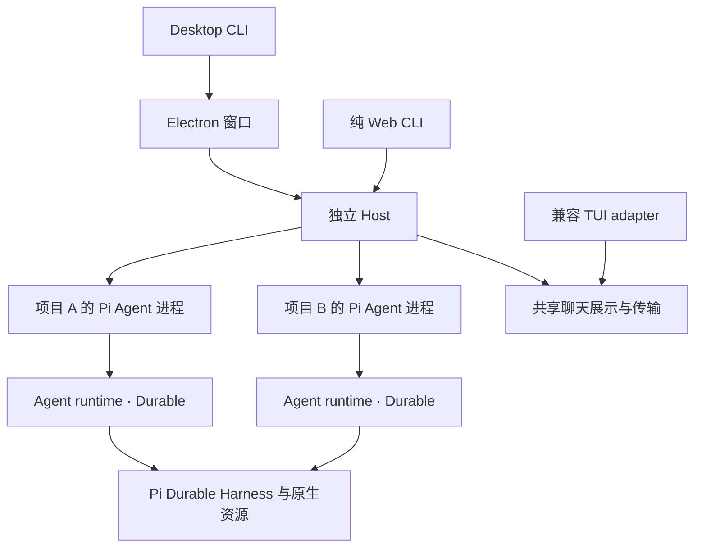

# 当前架构

Pi Desktop 使用已有 Pi Agent／Pi Durable 运行链管理多个项目和 Agent。Desktop、Web 和手机共享浏览器界面；不同运行 adapter 的所有权明确分开。

## 启动与运行所有权

默认 Host 只拥有项目／Agent 生命周期与路由；每个 Agent 的 Pi Durable 执行模型循环，Pi SDK 适配原生工具、扩展、技能、模板、MCP 和交互。TUI `/desk` 与单宿主模式是独立兼容 adapter，不能用其生命周期描述默认 Host。

Host interface 把 snapshot、请求目标、能力声明、会话操作和原生资源声明为一个 seam；bridge 只消费这个 interface，不再用可选键是否存在推断能力。能力由每个 adapter 显式声明，未声明即为 false；回调存在不会自动开启能力。target token 也由 `host.target()` 提供，bridge 不直接创建。TUI 复用同一 interface，并在切换聚焦 slot 时动态解析当前操作。

Agent snapshot 是一个共享 read model：宿主只提供消息、模型、工具、Git 和 capabilities 的事实，统一 shape、默认值与 typed activity 由 module 持有；`/api/state` 与 SSE 的既有字段保持兼容。typed activity 是新增字段，页面仍沿用原有 operation／phase 规则，避免改变既有可见状态文案。

原生资源 Session 的消息入口由 `native-runtime.mjs` 委托给当前 Durable Agent；模型轮次与实际空闲状态再映射回 Pi 生命周期。资源 Session 自己不能执行模型循环，插件主动创建的独立 Pi Agent 可以使用原有模型配置。扩展自定义记录随会话持久化，原生 widget 只投影为有界展示内容；关闭或更换资源宿主时释放事件订阅与组件。

## 会话同步与原生记录

活跃会话保存在 Pi JSONL，Durable 执行日志使用 SQLite。归档先可靠保存完整原生树到 SQLite 再移除 JSONL；恢复保持原 ID，检测已有 writer 与冲突。会话草稿属于客户端与 Agent，迟到请求不能清理另一个会话的输入。

导航、资源清单和聊天具有不同变化节奏。客户端获取有界消息页与索引，点开文件、思考或工具才请求正文。网络重连沿用 epoch／游标，不另建消息执行循环。

## 展示与发布资产 module

扩展卡片 interface 统一投影、摘要、布局和渲染。普通卡片随消息保留；状态卡片在当前会话按声明标识只展示最新一份。Goal adapter 与通用卡片共用规范，复杂 adapter 保留既有注册方式，清理按注册身份隔离。面板动作在注册时声明 command、prefill、refresh 和 focus-composer；工作台只转发 typed intent，页面不再从 HTML value 反解析命令。

写请求在开始时捕获请求目标，所有异步等待后通过同一个 guard 重校验 session 与 cwd；文件选择器、Git 预览／确认和 LSP 分析不再各自复制 409 规则。

Git 的 `read()` 返回 `limits` 和 `permittedActions`，页面只渲染服务端给出的 affordance；`prepare()`／`confirm()` 继续是路径上限、字节预算、动作许可和一次性确认的唯一裁决。

包管理清单也读取显式 capability：`updatesSupported`、`writable`、项目信任和 `packageRoot` 不再由回调是否存在推断；`requestContext` 只在 Host 声明该能力时调用。Durable 显式声明 sessions／newSession／switchSession／sessionCommand，保持既有 `/api/sessions`、新建和切换行为；bridge 只在声明后调用对应操作。

发布资产 module 统一公共 URL、磁盘文件与每种页面所需资源。各 Host 和预览只选择对应资产集合；压缩、ETag、HEAD 和缓存沿用统一 handler。目录可变，公共 URL 保持兼容。npm 检查从真实 tarball 验证资源闭包与完整文献，公开资产白名单不包含会话、配置或源码目录的任意文件。

源码职责见 [源码地图](source-map.md)，验证与限制见 [验证说明](verification.md)。历史取舍、旧设计和上游研究保存在 [文献入口](../README.md)。
