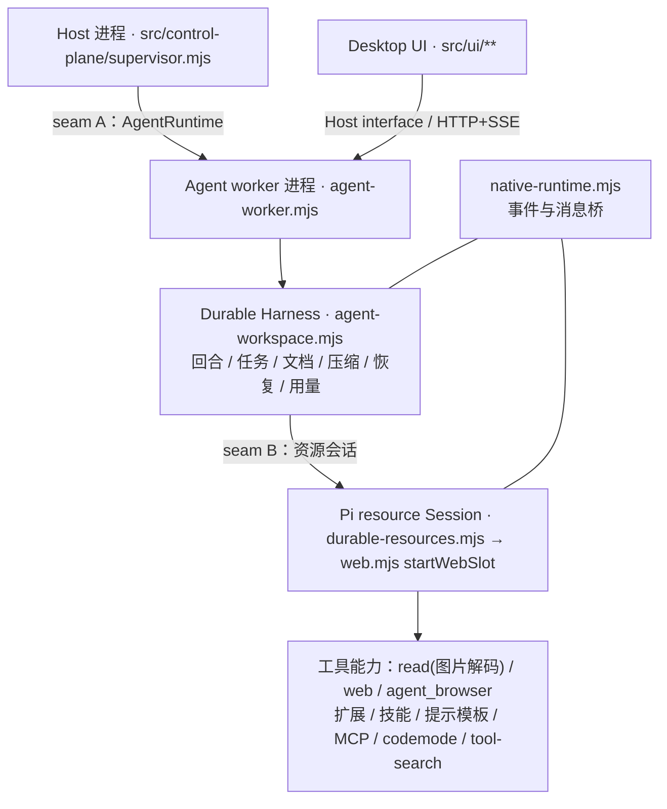

# Pi Durable 与 Pi SDK 的边界

本文固化 pi-desktop 对两个上游运行时的分工：`@earendil-works/pi-durable`（下称 **Durable**）与 `@earendil-works/pi-coding-agent`（下称 **Pi SDK**）。目标是让改动有归属：任何新行为先判断它属于哪一侧，再决定改哪里；跨越边界时必须经过文中两条 seam，而不是捷径。

英文术语（Harness／entry／commit／seam／adapter／capability）沿用上游原文，首次出现给出中文解释；实现细节见 [源码地图](source-map.md) 与 [接口契约](interfaces/README.md)。

## 官方定位

上游文档没有专门的边界章节，下面四段原文是本文全部判断的依据：

| 来源                                                                                                 | 原文                                                                                                                                                                                                                             | 结论                                                               |
| ---------------------------------------------------------------------------------------------------- | -------------------------------------------------------------------------------------------------------------------------------------------------------------------------------------------------------------------------------- | ------------------------------------------------------------------ |
| `@earendil-works/pi-durable` README 首段（本地 `node_modules/@earendil-works/pi-durable/README.md`） | "A durable agent harness. Conversations, model turns, tool calls, and your own state are committed to storage before anything is shown. If the process dies mid-turn, reopening the storage picks the work up where it stopped." | Durable 是**持久化 agent harness**：先落盘再显示，进程死亡后可续跑 |
| 同一 README 的 Concepts                                                                              | "**Task**: a durable state machine that saves a checkpoint at every step, so a restarted process continues from the last one."                                                                                                   | Durable 的深度是任务状态机与检查点，不只是模型循环                 |
| monorepo README 的 Packages 表（https://github.com/earendil-works/pi）                               | `pi-durable` = "Durable conversation, task, and document runtime"；`pi-agent-core` = "Agent runtime with tool calling and state management"；`pi-coding-agent` = "Interactive coding agent CLI"                                  | 两者是**同层并列**的两个 runtime，不是上下层                       |
| 官方博客 Pi Durable（https://earendil.com/posts/pi-durable/）                                        | "Pi Durable is that harness. **It does not replace the Pi coding agent.** It is a framework for building any agentic application, coding agents included."                                                                       | 官方明确不取代关系；方向是经验回流到 coding agent                  |

补充事实，同样来自上游文档：

- **事件兼容层是官方承认的**。Durable README 的 _Agent Events (Experimental)_ 原文："For consumers that want **coding-agent style events** (`message_start`, `message_update`, `tool_execution_start`, ...) instead of structural state" —— 本项目 `src/agent/native-runtime.mjs` 的桥接正踩在这一层上。
- **Durable 自带一套编码工具**。`@earendil-works/pi-durable/tools` 导出 `CodingTools`（`read`、`write`、`edit`、`bash`），注释写着 "nothing installs it automatically"。所以"工具属于 Pi"不成立：**基础工具两侧都有，差别在能力丰富度与资源系统**。
- **Pi SDK 不只是"工具包"**。`@earendil-works/pi-coding-agent/docs/how-pi-works.md` 把它自己的职责写成模型循环、context 组装（基础指令 + context 文件 + 技能描述）、会话树（JSONL 树、branch、active branch、fork/clone、compaction）、四种界面（interactive／print／JSON／RPC／TypeScript SDK）、扩展与资源、trust 与权限。它内部有另一套运行时（`@earendil-works/pi-agent-core`）。
- **Durable 的宿主无关性有第三方证据**：Cloudflare 官方 changelog 记录了在 Agents SDK 里运行 Pi Durable harness（https://developers.cloudflare.com/changelog/post/2026-10-02-pi-harness/），说明它被设计成可嵌入任意宿主的 harness，而不是某一种产品的内部件。

## 两条 seam

- **seam A（执行 seam，进程级）**：`src/control-plane/agent-runtime.mjs` 的 `defineAgentRuntime({ id, start })`。源码注释写明分工："The Host still owns spawning, restart, readiness and teardown. A runtime only owns the in-process agent harness behind that process." 目前只有一个 adapter：`createDurableRuntime()`（`id: "durable"`），由 `agent-worker.mjs` 用 `serviceMain` 启动。这是**假设 seam**（单 adapter），但位置正确：换 runtime 不需要改 supervisor。
- **seam B（能力 seam，会话级）**：`src/agent/durable-resources.mjs` 的 `createDurableResources(...)`，内部经 `startWebSlot()`（`src/server/web.mjs`）创建 Pi 资源会话。源码注释写明边界："Reuse the native resource loader, MCP implementation, package manager and UI interactions. This runtime never receives normal chat or runs a model loop."
- **桥**：`src/agent/native-runtime.mjs` 的 `createNativeRuntime({ workspace, id, ready, syncTools, onError })`。注释定义方向："Pi owns extension state and scheduling; Durable owns every admitted model turn. The resource Session never runs a second model loop."

## 拥有权表

| 关注点                                                                                                      | 拥有者                                | 源码锚点                                                                                                                                 | 可执行证据                                                                                                                      |
| ----------------------------------------------------------------------------------------------------------- | ------------------------------------- | ---------------------------------------------------------------------------------------------------------------------------------------- | ------------------------------------------------------------------------------------------------------------------------------- |
| 模型回合、任务状态机、检查点、压缩、重试                                                                    | **Durable**                           | `src/agent/agent-workspace.mjs`（`Harness`、`openNodeSqliteStorage`、`NodeExecutionEnv`、`lockfile`）                                    | `test/durable-*.test.mjs`、`npm run test:durable`                                                                               |
| 会话真相与持久化                                                                                            | **Durable SQLite（唯一 writer）**     | `openNodeSqliteStorage(...)`；Pi JSONL 只做互操作与归档：`src/session/pi-session-storage.mjs`                                            | `test/durable-features.test.mjs`、`npm run test:durable:recovery`（`test/durable-recovery-check.mjs`）                          |
| 基础工具 `read`／`write`／`edit`／`bash`                                                                    | **Durable**（`CodingTools` 显式安装） | `agent-workspace.mjs` 的 `CodingTools` 导入                                                                                              | 工具清单断言（projectless 场景）                                                                                                |
| 富工具能力：图片解码的 `read`、`web_fetch`／`web_search`、`agent_browser`、MCP、codemode、tool-search、技能 | **Pi 资源会话**                       | `src/agent/durable-resources.mjs` → `src/server/web.mjs` 的 `createCodemodeExtension`／`createToolSearchExtension`／`createMcpExtension` | `test/durable-features.test.mjs`、`test/agent-browser.test.mjs`                                                                 |
| 扩展与技能的加载与生命周期                                                                                  | **Pi**                                | `startWebSlot` 里 `SettingsManager`／`ProjectTrustStore`／`hasTrustRequiringProjectResources`                                            | `test/extension-manifest.test.mjs`、`npm run test:extensions:browser`                                                           |
| 权限策略（审批模式）                                                                                        | **Desktop 提供策略**，执行点分布两侧  | `src/agent/pi-permissions.mjs` 的 `validateApprovalMode`／`createApprovalExtension`；Durable 侧用 `hook(...)` 注册                       | `test/durable-features.test.mjs` 的权限门控断言                                                                                 |
| 交互（ask_user、MCP 提问）                                                                                  | Desktop 的交互存储 + Pi 的交互通道    | `src/agent/interaction-store.mjs`、`web.mjs` 的 `rpcQuestion`、`HOST_CAPABILITY_KEYS` 的 `interactions`                                  | `test/durable-features.test.mjs`、`test/remote-access.test.mjs`                                                                 |
| 模型与 provider 目录                                                                                        | `pi-ai` + Desktop 配置                | `src/agent/durable-models.mjs`、`@earendil-works/pi-ai/models`                                                                           | `test/durable-models.test.mjs`、`test/durable-network.test.mjs`                                                                 |
| 事件格式与增量窗口                                                                                          | **Durable 产出**，Pi 生命周期由桥镜像 | `src/server/durable-server.mjs`（delta window、`assistant_update`）、`native-runtime.mjs`                                                | `test/durable-delta.test.mjs`、`test/durable-browser-check.mjs`                                                                 |
| 设置、auth、网络代理由谁读                                                                                  | **Pi 内部子模块**，经懒加载适配层     | `src/agent/pi-sdk.mjs` 的 `loadPiSettingsManager`／`configurePiNetwork`／`scopedMcpCredentials`                                          | `test/pi-sdk.test.mjs`、`test/pi-sdk-lazy.test.mjs`                                                                             |
| 会话树投影（Host 只读视图）                                                                                 | Host 消费 Pi 的投影                   | `src/control-plane/pi-sessions.mjs`（`buildSessionProjection`）                                                                          | `test/desktop-pi-sessions.test.mjs`、`npm run test:sessions`                                                                    |
| 进程、项目目录、Agent 生命周期与路由                                                                        | **Host**                              | `src/control-plane/supervisor.mjs`（`createSupervisor`）、`src/server/host-interface.mjs`（`HOST_CAPABILITY_KEYS`）                      | `test/agent-runtime.test.mjs`、`test/desktop-process-recovery.test.mjs`、`test/host-interface.test.mjs`、`test/bridge.test.mjs` |
| 默认形态的界面                                                                                              | **Desktop 自研**                      | `src/ui/**`（聊天、工作区、工作台、面板）                                                                                                | `npm run test:browser`、`npm run test:workspace:browser`、`test/conversation-timeline-browser-check.mjs`                        |
| TUI 形态的界面与会话                                                                                        | **Pi**                                | `src/tui/**`（`ExtensionAPI`、`Theme`）                                                                                                  | `npm run test:remote:desktop` 的 TUI 覆盖                                                                                       |

## 四条边界规则

**R1 真相只在 Durable storage。** Pi JSONL 是互操作与归档的产物，不是第二个真相源。

- 做法：新状态写进 Durable 的 entry／document；Pi 会话文件只通过 `src/session/pi-session-storage.mjs` 的导出／导入流程参与。
- 反例与后果：直接改 JSONL 或让 Pi 会话成为并列真相 → 崩溃恢复后两套历史分叉，`openNativeTranscript`／`assertNoNativeTui` 的单 writer 断言会失败，归档无法判定保留哪一份。

**R2 不在 Desktop 侧重建资源加载。** 扩展、技能、提示模板、MCP、codemode、tool-search 永远用 Pi 的。

- 做法：需要新能力时先看 Pi 是否已提供；Desktop 只用 `defineExtension`／`defineTool`／`section`／`hook` 注册自己的工具与提示段。
- 反例与后果：本仓库实测过一次——为省启动时间把只读资源会话延迟创建，结果 read（含图片解码）、权限门控、ask_user／MCP 与 `agent_browser` 注册一起失效，6 个 `test/durable-features.test.mjs` 用例失败，实验被回滚。自己实现资源加载器则会同时失去生态兼容（用户 `~/.pi` 扩展、技能、MCP 配置）。

**R3 事件方向单向。** Durable commit → 事件流 → `native-runtime` 镜像成 Pi 生命周期事件；反向不得驱动 Durable 状态。

- 做法：新的流式更新加在 Durable 侧（如 `assistant_update`），由桥翻译；Pi 事件只用于扩展状态与调度。
- 反例与后果：用 Pi 事件反向改写 Durable 状态 → 出现第二个模型循环、重复记账；`native-runtime.mjs` 注释里"resource Session never runs a second model loop"正是防止这一点。

**R4 Host 不知道 Durable 内部。** `src/control-plane/supervisor.mjs` 只做 spawn／就绪／重启／归档／路由。

- 做法：会话语义放在 worker 内、经 Host interface 暴露为 capability；新增能力必须先在 `HOST_CAPABILITY_KEYS` 声明。
- 反例与后果：supervisor 直接读写 SQLite 或会话文档 → 绕过 `agent-workspace.mjs` 的 `guard()` 与事务边界，跨 runtime 替换不可能，远程裁剪也失去唯一裁决点（`src/server/target-guard.mjs`）。

## 边界稳定性

- **能力 seam 已被两种形态验证**：默认 durable 形态与只读 web／pi-history 形态共用同一 Host interface 与同一资源加载路径，说明 seam B 是真的（≥2 个 adapter 消费同一 interface）。
- **执行 seam 是假设 seam（1 个 adapter）**：只有 Durable runtime。接第二个 runtime 的成本不在 spawn，而在单 writer、事件映射、崩溃恢复与 capability 对齐四件事——这也是 R1／R3 要守住的原因。
- **上游没有"取代"计划**：发布版 `pi-coding-agent` 的 `dist/` 中没有 `pi-durable` 引用；源码仓库里的 `packages/coding-agent/src/experimental/durable` 属于实验目录（仅在搜索结果中确认路径，未在已发布包中验证）。

## 已交付深化与后续范围

已接入 Durable 的定点重启／恢复可见性、Pi 的原生树退回／分叉，以及任务与子代理管理。下面区分当前能力和仍未接入的范围，不能把已交付的管理面继续列成 backlog。

### 子代理与任务图管理（Durable 原生 API，已接入）

- **执行与真相**：`taskGraph()`／`inspect()`／`getTask()` 提供任务视图；`waitForTask()`／会话 `waitForIdle()` 观察；`abortTask()`／会话 `abort()` 中止。调度、检查点、owned 级联取消、恢复与终态全部属于 Durable。
- **子代理适配**：`src/agent/managed-subagents.mjs` 通过公开 `defineTask`、`tx.createConversation({ ownership: { kind: "task", taskId } })` 与 `submit()` 注册一次委托；不是 SDK 自带的同名 `subagent.spawn()` 管理器，也不另建执行器。答案只读取 submission 决定的 `answer` 对应 `AssistantEntry`，不扫描当前上下文猜测结果。
- **管理面**：工作台消费 scoped `/api/tasks`；本地全 Host 窗口消费 `/api/host/tasks`，仅聚合已运行 worker。管理命令转发现有 `/api/command`，Host 不读取 Durable SQLite。等待、单任务中止与详情共享原生回执投影；`marked` 不等于 aborted，等待成功不等于执行成功。
- **权限与限制**：管理范围沿任务 `owner`，不是历史 `parent`；每 Agent 一个 worker／SQLite／writer。保留只读、generation 与生产远程裁剪。没有公开原生方法支持的暂停、重排或重试管理不自行补一套实现。具体行为与证据见[任务图契约](interfaces/task-graph.md)及[Host 任务契约](interfaces/host-tasks.md)。

### Pi 工具／扩展面板深化（Pi 侧）

- **现状**：工具清单与扩展状态经资源会话投影到聊天与工作台；`describe` 类信息有限，扩展卡片以事件驱动为主。
- **设计草案**：用 `resources.describe(...)` 扩展工具／扩展元数据（来源、权限域、可用状态），在 UI 侧做成只读清单；不改 Pi 的加载语义。
- **待验证点**：扩展状态在重载（`reload` capability）后的稳定性；远程形态下哪些元数据必须裁剪；描述字段新增是否影响既有卡片契约。

## 限制与未验证

- monorepo README 在抓取时被截断（8K 字符），因此 `pi-codemode`／`pi-mcp`／`pi-tui` 的官方角色描述不在 Packages 表中；本文对其定位来自本地依赖图（两者都是 `pi-coding-agent` 的直接依赖，且 `pi-durable` 不依赖它们）。
- 官方博客与 Cloudflare changelog 属于官方非规范来源（规范是 Durable 仓库的 `docs/spec.md`，本项目未引入）。
- 本文的"拥有权"结论来自源码事实（文件与函数名已逐条列出）；四条规则是**本项目自己的工程约定**，不是上游原文。
- 未做：跨 runtime 迁移验证、第二个 runtime adapter、上游 `spec.md` 逐条对照。

## 相关文档

- 接口契约：[interfaces/README.md](interfaces/README.md)
- 源码职责：[source-map.md](source-map.md)
- 验证与既有能力：[verification.md](verification.md)
- 当前架构总览：[README.md](README.md)
- 原生任务 API 收口与验证：[native-task-api-management.md](../history/native-task-api-management.md)
