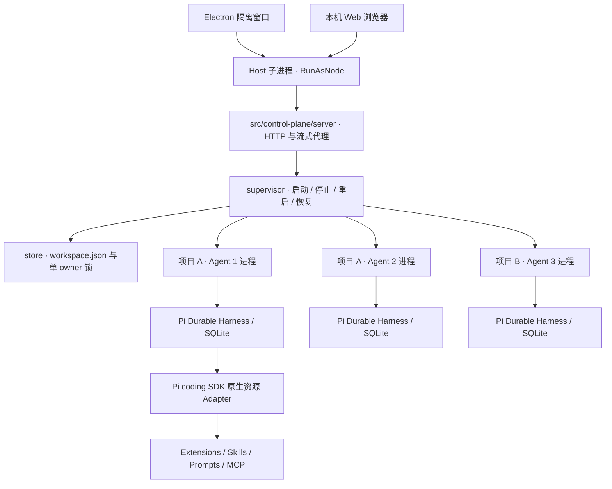
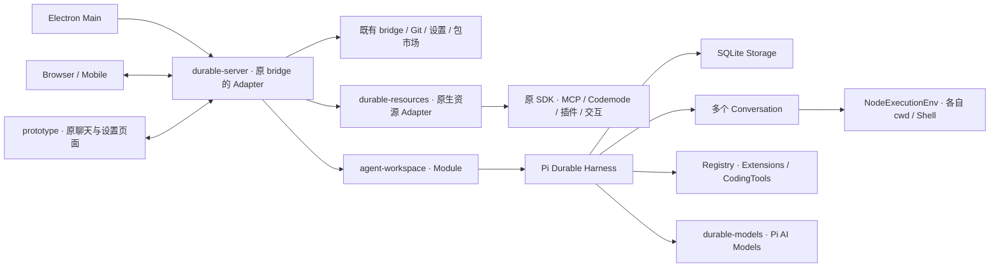
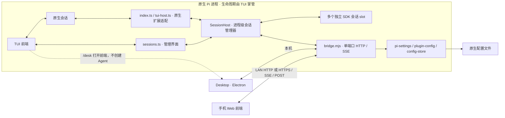
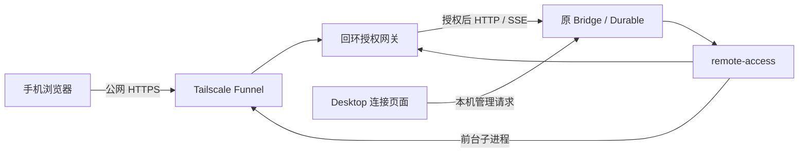

> 目录整理前的完整资料快照；历史说明可能已被取代。当前文献见 [入口](../README.md)。

# 0.26.3：npm CLI、网络代理与界面字号

发布边界由 `package.json.files` 显式限定为运行时代码、Desktop/Web UI、Pi 扩展入口、许可证和设计文档；测试、参考仓库和本机数据不进入 tarball。`pi-desktop` 与 `pi-desk` 是同一个 thin CLI Adapter：不带 URL 时解析 Pi Desktop 参数并启动 Electron；`deskOptions` 保留 `--port`，将它传给本机 HTTP Host。`pi-web` 单独启动浏览器入口，不启动 Electron。`prepack` 先做类型与语法检查，`npm run package:check` 对真实 `npm pack --dry-run` 清单做边界验证。

代理配置沿用 Pi 全局 `SettingsManager` 的 `httpProxy` 字段（秘密输入、禁止项目覆盖），由 Pi coding-agent 的 HTTP dispatcher 读取；已存在的 `HTTP_PROXY`／`HTTPS_PROXY` 环境变量优先，`httpProxy` 只补齐缺失值。Desktop 不引入第二套代理文件或自有网络栈。保存后的配置在各 Pi Agent 进程下次启动时生效，TLS 证书校验沿用 Pi 与 Node 默认行为。

字号由 `prototype.js` 的 Appearance Controller 写入浏览器本地偏好，通过 `--ui-font-size` 与 `--ui-font-scale` 同时驱动聊天、设置和外层项目侧栏；固定像素字体也乘统一 scale。Ctrl/⌘+=、Ctrl/⌘+- 与 Ctrl/⌘+0 复用相同的持久化入口，字号限制为 12–24px，不改 Chromium 全页面缩放，也不另建字号配置后端。

## 当前：扩展展示适配与字号覆盖

`extension-adapters.mjs` 是 Web/Desktop 的唯一扩展展示 seam。Pi 负责扩展生命周期、权限、工具执行与 `custom_message` JSONL；展示 adapter 将原生消息或工具结果投影成有版本的轻量 view model，再安全渲染。`details.piDesktop` v1 提供通用声明式卡片，复杂插件才需要注册 projector/renderer。注册返回 disposer；切换会话通知 adapter，释放时清除自身资源。

`pi-goal-x` adapter 处理 goal v3 快照与 `pi-goal-event`／`pi-goal-audit-event`，展示目标、任务、用量及验收。历史和实时快照都读取 Pi 的 `custom_message` 记录，归档／恢复继续使用原生 JSONL；不复制插件状态或重写生命周期。Todo 专用面板、状态投影与 SQLite 快照已移除；Todo 工具若由 Pi 配置加载，仍由 Pi 按普通工具运行。

展示 interface 兼容既有 `register/project/render/setSession/dispose`；`summary` 和 `layout` 将原先泄漏到时间线与页面的摘要、摆放、去重规则收回 `extension-adapters.mjs`。Goal 与声明式卡片共用规范及 renderer，目标工具名和旧 Goal 字段只存在于该 module。普通卡片随消息保留，状态卡片按会话、adapter 与声明 key 选取最新一份。流式重绘仍只替换当前回合的 DOM，但状态选取来自全部已加载消息，并跳过状态卡片确定当前活动行；状态卡片不能令历史思考重新闪烁。未知版本或 renderer 失败保留原文回退。

每次注册拥有独立 entry 和 cleanup。释放先使该 entry 失效并移除当前身份，再执行 cleanup/onDispose；`dispose()` 后同 ID 新注册不会被旧 disposer 删除或清理。释放和异常回滚都幂等，单个 cleanup 失败不会中断剩余清理。这只修复已有注册语义，不扩展 `/btw` 或重写 Pi 的运行生命周期。回归通过同一 interface 覆盖投影、规范、布局、渲染、身份隔离，以及独立浏览器页面中的跨回合状态卡片与展开恢复。

生命周期原则参考 DSH Cordis：资源随模块注册并在切换／卸载时释放；不引入 Cordis 到 Pi Agent 运行链。

## 0.22.0：模型菜单与 Tailscale 进程所有权

公网探针复用 HTTPS CONNECT 代理与环境解析库，显式校验代理和目标证书，只影响公开 HTTPS 探测。Funnel DNS／网络暂时失败可在最多十分钟的预算内重试，证书与网关身份异常立即拒绝，等待及卡住的 CONNECT 均可取消；通过后才发布二维码。工作区周期请求不与已有读取重叠，原生交互轮询复用当前请求，避免高延迟网络占满连接。实网中继／扫码鉴权与用户手机刷新结果见 remote-access-review.md。

Composer 的模型按钮展示 Host 报告的模型名与思考强度。独立 DOM controller 管理固定定位的上拉菜单、模型／effort 二级页面、提供商搜索、当前项、选择期间禁用、键盘和焦点；原 Pi 模型目录与 HTTP API 仍为权威。旧 model-controls 仅用于单宿主兼容模式，Desktop 不再通过 openModels 模态窗口选模型。长名称省略显示并提供完整 title，小屏隐藏 effort 副标题；菜单按 iframe 视口约束宽度和上方高度，减少动态效果时禁用动画。

远程页面以 prepare 动作自动准备 Tailscale，但不自动发布公网连接。运行时优先探测已有系统服务，不接管它；不存在服务时创建私有目录，以 userspace-networking、独立 socket 与持久 state 启动应用拥有的 daemon。所有 CLI 命令使用同一 socket prefix。首次连接自动运行原生 up，安全展示官方登录 URL；没有自动接受账号或策略授权。daemon 异常退出提供最多三次渐进重启，Desktop 存活期间保持运行；停止共享仅关闭本次 Funnel，Desktop 退出关闭其拥有的 daemon 和登录子进程，保留持久登录状态和既有系统服务。daemon 失效立即撤销二维码及代理授权，恢复后返回就绪入口；再次开启经过原严格公网校验才生成新二维码。

精简界面保留 Pi 色彩，减弱网格和边框；动效仅用于状态过渡，避免每次消息流重新动画。模型菜单、设置切换、按钮反馈有界为 120–160ms，reduced-motion 全部禁用。新回归跨真实模型切换、搜索、effort、自动 prepare、临时 daemon 启动／退出／恢复、真实用户态二进制及已有远程鉴权。

## 0.21.0：全局配置、AGENTS.md 人格与多项目扫码

移除主管层的项目／会话注入表单与 effectiveInjections 合并；资源由 Pi 全局设置及其原生发现规则加载。旧清单字段保留但不执行，显式提交旧 injections 字段返回 422。全局人格直接编辑 agentDir/AGENTS.md；可选人格正文保存为 workspace/personalities/UUID/AGENTS.md，选择使用现有 Durable configure seam。读写有界、UTF-8、固定路径、O_NOFOLLOW、内容 revision、文件写锁和原子替换；旧 JSON 提示词在首次编辑前兼容读取。只读会话通过 Pi agentsFilesOverride 复用 loadProjectContextFiles，仅保留全局上下文文件，不发现项目／祖先指令，也不扩大工具权限。

Supervisor 的 shared seam 在全部 Pi worker 空闲时运行全局修改。Host 在整个读写／更新／重载期间拦截新 POST 请求；单个更新、共享资源配置也走同一主管门禁。全量更新以独立的内部 cwd 和 projectTrusted:false 创建 Pi 原生 SettingsManager／DefaultPackageManager，调用 update()，对应 --extensions；单个更新继续 update(source)。更新确认覆盖用户声明、配置 revision 和实际安装版本；原生选择、固定版本与写回逻辑保持不变。人格保存自动重载空闲资源；插件更新提示重载，由用户决定应用时间。

默认多进程 Host 复用 createRemoteAccess 和前台 Tailscale Funnel。二维码带主管层 Agent UUID，兑换 HttpOnly Secure Cookie 后转到同一工作空间；父页面选择持久在该浏览器的 sessionStorage。根路径与 /agents/UUID/api/remote 均由鉴权网关拦截，手机不接触发布密钥或发布管理。Host 关闭先撤销网关，再关闭 Agent 与数据 owner。实际公网连接依赖电脑的 Tailscale 登录、HTTPS/Funnel 授权和可达网络；隔离测试使用本机 TLS 中继，未自动发布真实项目。

验收增加 test/desktop-global.test.mjs、实际 Pi 包管理器的全量更新夹具与 test:remote:desktop；手机测试解码二维码、验证 HTTPS Cookie、发送消息到选定项目、切换会话、刷新恢复、320/360/390px 和撤销访问。

# Pi Web / Desk 的设计与边界

## 0.20.0：侧栏视图与通用工作区浏览器

设置自动收起主管导航，退出设置恢复手动状态；收起的聊天顶栏可恢复导航。工作区视图菜单按 DSH ViewOptionsMenu 提供分组、排序、归档过滤，目录树按最近注册祖先组织。Desktop 添加工作区先调用原生文件夹选择器，取消不产生数据。

右侧以标签承载网页、项目文件、改动和工具输出。`workspace-panels.js` 负责 DOM／标签与既有 Git 视图协调，`workspace-files.mjs` 为只读、Agent 根目录绑定的文件预览接口。`agent-browser.mjs` 为每个 worker 管理独立 Chromium 会话、profile 与短私有 socket 目录，调用 `pi-agent-browser-native` 原始工具并通过既有 Pi tool_call、审批和 Durable 注册链执行。会话、内核、连接和证书设置固定，工具无法切到其他浏览器；无项目仅开放浏览读取。上游最新 JPEG 缓存在内存，`/_browser/frame` 返回当前帧；`/api/browser` 只接受标签、HTTP 导航、有限输入和视口尺寸，原始 CDP 与 WebSocket 不暴露。`agent-browser-view.js` 单次请求画面、跳过旧帧、合并输入，侧栏隐藏即停止画面请求；Desktop、Web 与手机复用同一显示与控制路径。停止 worker 先取消浏览器输入，再释放 Harness、原生资源与浏览器。旧单宿主继续使用现有 WebContentsView／iframe 兼容面板。添加项目的 Electron dialog 与本机 Web 系统选择器同样返回有效目录，取消不写项目，远程网关拒绝触发电脑文件夹选择器。

验证覆盖侧栏与设置实际隐藏／恢复、菜单三组选择、系统目录选择调用与取消、真实文件文本、Native 网页／隔离／历史、草稿／附件保持、窄屏和 Electron 关闭清理。浏览器用本机静态网页，目录选择夹具替换系统对话框结果，不修改个人配置、不调用真实模型。

## 0.18.0：会话导航与用量胶囊

外层不再显示重复标题、功能页签或注入／进程操作栏。项目中的 Agent 与无项目会话在左栏展示，项目可折叠；底部设置入口进入复用 prototype 的独立设置主视图。人格与提示词是设置分类，通过限定 origin、活动 iframe 的消息选择独立 AGENTS.md；原生插件／模型设置需启动 Agent。创建对话仅显示名称及必要目录。会话右键、Shift+F10／ContextMenu 和旁侧省略按钮打开管理菜单，操作捕获目标 ID，不改变其他会话的选择；操作及进程过渡阶段禁用，完成后同步恢复。菜单支持方向键、Escape 和焦点返回；无变化轮询不替换导航 DOM。

用量胶囊参考 DSH StatsPills，点击展开精确计数。模型累计 input/output/cacheRead/cacheWrite/totalTokens 来自 pi.usage 的 models 账本，费用包含模型与工具；缓存命中率为 cacheRead / (input + cacheRead + cacheWrite)，无输入时未知。上下文独立读取公开 Conversation.context，使用 head 后最新 assistant 的真实 usage，加 Pi AI 公开估算函数计算后续消息；压缩后等待新响应，不能复用旧测量。估算显示 ≈，没有容量时不编造百分比。账本包含压缩请求，重启保留累计量；浏览器和实际 Electron 覆盖菜单目标、停启／重启、设置、草稿、真实缓存比例和手机尺寸。

## 0.17.0：无项目会话与默认只读权限

控制层 Agent 的 `projectId: null` 表示无项目会话，权限固定为 `read-only`；项目 Agent 为 `workspace-write`。Host 首次启动创建默认无项目会话，每次启动确保默认会话运行，恢复其 SQLite；点击品牌返回默认会话。`conversation.create` 在主管进程串行队列中保存、记录运行意图并启动进程，用于无项目与项目的新建入口；启动失败仍保留可重试的会话记录。

无项目 cwd 为 `agents/<UUID>/context`，与项目 cwd 无关。Supervisor 不传入第三方扩展路径；原生资源加载关闭扩展和项目上下文文件，Skills 与模板继续复用原生加载器。无项目 Agent 仅注册 Durable 的 read 和本地定义的 web_search/web_fetch；后者使用 HTTP GET、取消、超时、2 MiB 响应上限与文本提取。ExecutionEnv 同时拒绝所有写操作和 exec；配置 API 不允许添加其他工具或更换 cwd，Git 写入／LSP 执行和项目权限提升被拒绝。注册清单也限制未知或伪造的模型工具调用。此处约束应用能力，未实现操作系统进程沙箱。

插件管理仍由 package-management 与 Pi DefaultPackageManager 完成，显式用户操作可以改变全局包声明。读取／网页会话不执行安装的第三方扩展；项目 Agent 重载后应用启停和工具清单变化。本地包的更新与卸载先用原生 getInstalledPath(source, scope) 解析身份，避免相对 agentDir 的声明被错误地当作相对 cwd 的输入。

外层工作空间和既有聊天页共用官方三色 Pi SVG 和 pi.dev 配色。明暗主题通过同源 storage／parent 消息同步；切换主题、设置或 Agent 不丢弃聊天草稿和 SSE。无项目页面隐藏项目 Git 功能并默认收起右栏，工具输出仍可按需打开。

## 0.16.0：项目控制层与独立 Pi 进程

`store` 只负责项目与 Agent 的持久化目录、配置校验、revision 和单 owner。目录经 realpath 校验；注入路径解析为绝对路径，项目路径不可原地改为另一个仓库。Agent UUID 是控制层身份，与 Durable conversation ID 分开。

`supervisor` 暴露 `read / execute / target / restore / close`，进程句柄保留在服务端。每个 Agent 的 SQLite、模型和认证目录由其 UUID 确定；启动始终使用该目录。资源从全局原生设置加载，选定人格从独立 AGENTS.md 读取并追加。运行状态与 PID 来自实际子进程；期望启停状态持久化，重开 Host 只恢复仍期望运行的 Agent。启动失败没有无限自动重试；失败状态可检查并手动恢复。

`process` 封装 Node fork / Electron RunAsNode、IPC ready、启动期限、优雅关闭及 SIGTERM/SIGKILL 兜底。父进程退出触发 IPC disconnect，子进程自行关闭。Electron main 只管理窗口与 Host；模型循环、插件和 SQLite 均在 Agent 进程中。借鉴 DSH 的 Host 与 backend-controller 生命周期，但不引入 Cordis 或 DSH 模型执行层。

`server` 只允许本机 Host、同源 JSON 写请求与已登记 Agent 的代理目标。代理连接地址只能来自主管进程的 IPC ready；用户不能传 URL。HTTP/SSE 按流传递，剥离 hop-by-hop headers；内嵌原 Pi 页面以 `/agents/<UUID>/` 为路径前缀，资源、API 与 SSE 均留在同一 Host origin。单宿主页面禁止被 frame 嵌入，托管工作区页面仅允许同源父页面。控制层不读取模型密钥。

`src/ui` 只实现项目导航、进程状态与注入配置表单。聊天、包管理、模型设置、Git、MCP 和交互继续复用 prototype 与既有模块。每个已打开 Agent 保留自己的 iframe，切换不卸载，草稿与 SSE 继续由原界面管理；停止进程时才释放页面。经过 origin、parent 与消息类型校验的 view 消息切换设置页面，不重新加载聊天页。

`durable-server` 增加 singleAgent 模式，阻止从子页面另建会话绕开主管进程。`durable-resources` 将 nativeResources 交给 Pi SDK；`web` 使用真实 `additionalExtensionPaths / additionalSkillPaths / additionalPromptTemplatePaths / appendSystemPrompt`。这些是原生资源注入，不另写插件加载器。Pi Durable 负责模型生成、工具任务、压缩、持久化、幂等与恢复；原 coding SDK 负责资源，不启动另一个模型循环。

旧单宿主通过 `--single-process` 保留，并沿用原数据路径；多进程目录默认为 `desktop/workspace`。此 MVP 不自动迁移历史，通过 Tailscale 网关提供远程多进程访问，尚不提供安装包。Pi 插件仍可使用用户／项目范围配置；多个独立进程并非 OS 权限隔离，不能保证所有第三方插件都是多进程安全的。

验收跨真实 HTTP、真实模型协议夹具、实际 Pi 子进程、SQLite、Chromium 和 Electron；崩溃隔离测试 SIGKILL 一个 worker，另一个仍服务，再等待正常 lease 过期并恢复同一会话。运行 `test:workspace`、`test:workspace:browser` 和 `test:workspace:desktop`。

## 0.15.0：Desktop 管理 Pi Durable

默认入口由 Desktop 持有 Durable Harness。多个 Agent 是并行 ownerless Conversation，各自保存模型、工具、扩展和 cwd。Storage、任务调度、请求去重、恢复、压缩与 ownership 取消使用框架的权威实现。原界面和功能模块在 bridge seam 上复用，以下章节同时记录原生 TUI Adapter。

### 会话同步、原生资源、草稿与包管理

`session-inventories` Module 管理资源清单的生命周期，Interface 为 `refresh(snapshot,{force?})` 和 `invalidate()`。它按 Agent、目录、配置及运行阶段合并请求，独立处理插件／提供商的失败，丢弃旧目标的迟到结果。聊天快照立即呈现；Durable 会话列表直接取自同一快照。有效清单在后续活动中最多缓存 30 秒，写操作使缓存失效，进入管理页面强制刷新。资源清单失败不改变 SSE 连接状态，管理页面显示加载错误。

`agent-workspace.agent(id)` 只读取 Agent 配置与资源 Document，不投影 transcript。Durable 的资源清单 GET 使用这个 Interface；聊天 `/api/state` 继续读取完整 committed view。资源 GET 不执行无关的 Git 元数据读取，专用 Git 请求仍使用原 Git Module。HTTP JSON 与 SSE 继续使用共用压缩传输。

`durable-resources` 的资源 Interface 为 `read()`、`describe(catalog)` 和 `execute(action,...args)`。原生 SDK Session、内部扩展命名、工具作用域、原生会话 ID 转换、命令／模板／技能展开及重载后的工具选择都由 Adapter 管理。`durable-server` 只消费资源行为与业务值；Registry 仍是新工具与 Durable 扩展的 seam，原生 SDK 不参与第二个模型循环。

`session-drafts` Module 持有各 Agent 的文字、附件、当前选择与重试身份。`select`／`edit` 管理输入，文件操作绑定捕获的 owner，`capture` 冻结提交内容，`complete` 只清除相同文字与已发送附件。内容或模式变化建立新 requestId；同内容失败重试复用身份。DOM、FileReader 和 HTTP 是页面的 Adapter；它们不持有第二套草稿 Map，迟到读取不能恢复已移除文件。页面刷新仍不会持久化未提交附件。

`package-management` Module 的 Interface 为 `read()` 和 `execute(action,input)`。清单投影、原目标、信任、共享空闲、revision／inventoryKey、来源身份、更新提示和互斥锁集中在同一个操作生命周期。写锁从异步校验前持有到原生操作结束，失败也释放；HTTP bridge 只解析请求、返回结果并发布事件。TUI 与 Durable 两个 Adapter 继续调用 Pi 原生包管理，不自动 reload。

这些 Module 的 depth 来自集中生命周期规则，提供 locality；原界面、两个宿主 Adapter 与测试复用同一 Interface，提供 leverage。浏览器回归跨真实 HTTP seam 验证插件清单等待／失败时流式聊天仍可用，以及提交响应迟到时的草稿归属。

### Module、Interface 与 seam

`agent-workspace` 是 deep Module，Interface 为 `read(id?)`、`agent(id)`、`execute(command,input)`、`subscribe(listener)`、`install(extension)`、`close()`。调用者只需要目标 ID、命令与业务值；不用知道 Chord Context、Document token、任务状态机、Storage 分页、Registry tool 对象转换、lease 或 view.dispose。HTTP 与测试跨同一个 seam，使用真实 Durable 的 MemoryStorage 和 SQLite Adapter。

Depth 来自配置原子提交、环境恢复、工具选择、去重和资源清理集中在这个 Module，提供 Locality；Electron、Web、手机和测试不重复这些规则，得到 Leverage。SQLite／MemoryStorage 与可注入 ExecutionEnv 是实际变化的 seam，没有为假设的第二个框架造抽象。工具、提示、hooks 和 tasks 通过 Registry 扩展，增加工具不修改工作区和前端；UI 从 Registry 生成清单，遵循开闭原则。

`durable-models` 管理公开 Providers／CredentialStore 和独立持久化；`durable-server` 将 Durable 的 committed view 与操作映射到既有 `createDeskBridge` Interface，原 bridge 继续管理 HTTP/SSE、Git、设置、包市场、认证与附件。每个请求用 AsyncLocalStorage 捕获目标，原 `prototype` 页面保存本客户端的选择与草稿。新增两个可选 seam：`requestContext`／`route`，不改变旧 Adapter 的默认语义。

`durable-resources` 复用 `startWebSlot` 的资源加载、原生插件、MCP、Codemode 和 UI 交互，以 in-memory SessionManager 提供 ExtensionAPI 上下文。普通聊天永远交给 Harness；资源运行时拒绝模型请求。官方 CodingTools 也注入原生工具环境，所以 Codemode 嵌套调用使用当前 Durable task 的 cwd／Shell／环境。Tool Search 的真实工具选择在任务 commit 中写回 Durable。Pi 插件 `custom_message` 记录作为普通会话消息投影；桌面插件展示只从视图 adapter 读取元数据，不再建立 Todo 专用 Document。原生工具未声明 replay，不能自动重放。资源的跨版本差异集中在 Adapter。

### 持久化与生命周期

名称和环境存入 rewindable `desk.agent` Document，与 Agent 配置在同一 commit 修改并校验 revision。修改运行配置前，在同一提交线上读取未完成任务。Environment 每次从持久化 cwd／Shell 配置构建；`AGENTS.md` 从同一环境读取。它不是 OS 沙箱。

HTTP 没有全局 focus，所有变更显式指向 Conversation。失败重试保留 requestId，成功只清理捕获的目标和原文。SSE 只通知重新读 committed view，断线从快照恢复，没有额外消息 reducer。view 读取后即 dispose，不把所有历史正文常驻内存。慢客户端受缓冲上限约束。

Electron managed 模式忽略旧 `PI_DESK_URL`；退出先关闭 Harness／HTTP，重开后 resume 未完成任务。Storage lease 阻止第二个宿主，崩溃后等待十秒 stale interval，不移除活跃 owner 的锁。隔离 preload 只暴露目录选择 IPC，渲染进程无 Node 能力。

### 兼容与删除范围

默认链移除了 URL 必选与 TUI 命令网关依赖，使用 npm 内嵌 Durable 与原生 SDK。`bridge`、`prototype`、`startWebSlot` 被默认模式直接复用；旧 `startWeb`、TUI host 与 SessionHost 仍有兼容调用者。移除先前新增的 `desk.html`／`desk.css`／`desk-ui.mjs`，不维护第二套页面。本轮不声称全仓库已无死代码。

框架只从公开导出访问，`~1.0.2` 加 lockfile 和契约回归控制升级；实验框架未来破坏性变化仍需适配。旧 JSONL 历史没有自动迁移；ExtensionAPI 工具在资源 Adapter 内运行，依赖原生模型循环的 hooks 与自定义 TUI 控件不能承诺通用支持。没有复制框架实现或修改第三方包。

## 兼容 TUI Adapter 的历史设计

## 产品与布局

发布单元仍是 pi extension package：`pi.extensions = ["./index.ts"]`。Web 是 pi 的界面和配置上层，工具、模型调用、认证、包安装和会话生命周期交给 pi。

默认布局按照已读取的 ZCode / DeepSeek Harness Web：工作区与会话左导航、主会话、右侧常驻 Git 工具卡。“审查”显示变更来源与单文件 diff，“工具输出”保留原有预览，“提交”只处理已暂存文件；不是 Git 弹窗或额外配置页面。手机使用按需右抽屉与左导航抽屉。设置仍是主视图的独立页面，带分类导航和范围选择。

全局视觉使用原 pi.dev 色板、字体、网格和基础 4px 圆角；ZCode 仅参考工作区／Git 交互，不覆盖页面主题。语义字号、间距与明暗主题沿用现有 CSS token，手机输入 16px。配置字段服务操作，不使用营销式内容填充面板。Web 外观主题存浏览器，Pi 终端 theme 属于原生设置。

## 一个后端、三个前端

TUI、Desktop 和手机 Web 是前端，Pi-Agent 是唯一会话与运行状态的权威后端。采用“后端随 TUI 运行”的生命周期：TUI 与 Pi-Agent 共进程，但职责分层；关闭 Desktop／手机不停止 Agent，退出 TUI 才统一结束后端与连接服务。

`/desk` 启动 bridge 并将其本机 URL 交给隔离的 Electron 窗口；启动器不继承 TUI 的输入输出，也不启动另一个 Pi。显式 URL 优先于 `PI_DESK_URL`，防止旧环境变量把 Desktop 导向另一个后端。`/desk web` 只启动连接服务；`/desk stop` 只停止该服务。Desktop 与手机使用同一快照和事件协议，没有控制权切换。

`tui-host.ts` 在 Pi 进程内持有 bridge、后端 ID、原生适配上下文与前端操作队列，不依赖单次扩展 factory 的生命周期。原生 `session_shutdown` 的 new/resume/fork/reload 是重新绑定，不是后端退出；quit 才关闭 bridge。重新绑定期间快照明确标记 replacing 和不可操作，成功后沿用端口和 epoch。若扩展在重载中被移除、factory 在 30 秒内未重新加载，则清理连接服务，避免遗留旧适配器。factory 已加载但其他启动监听器正在等待原生交互（如 MCP OAuth）时取消该清理计时，保留服务直至新上下文绑定。

前端控制通过内部 `/desk _action <requestId>` 进入 Pi 的原生命令分发，取得**本次操作的新鲜 ExtensionCommandContext**；不会复用首次 `/desk` 的旧上下文，也不会将控制命令送给模型。模型等原生操作通过此队列执行，重载使用 `ctx.reload`；托管新建／恢复由 `SessionHost` 创建或复用独立 SDK slot，不调用原生替换接口。模型与思考使用公开 ExtensionAPI，消息／技能／模板同样由 Pi 执行。会话恢复只接受当前工作区清单中的 ID，不接受任意文件路径。

消息、工具、模型、思考、名称、会话树与压缩事件触发共享快照／增量更新。队列、独立 usage 条目与工具 loadout 没有完整的公开扩展事件，因此仅在 SSE 客户端连接时每 250 ms 检查原生状态指纹；不轮询或序列化消息正文，变化才通知刷新，客户端离开则停止检查。统计按原生 getSessionStats 的全 entries 语义累计，包含压缩／分支总结／工具用量，并以真实 Pi 结果校对；上下文估计直接读取原生接口。前端草稿、主题、滚动和折叠不作为后端状态共享。

## 同进程多会话管理与 `/sessions`

SessionHost 是唯一 registry、transport 与显示 focus 的所有者；native slot 是既有原生上下文的适配，其他 slot 各自持有 SDK runtime、消息投影和交互仓库。管理器的 snapshot、HTTP 路由与 TUI 管理视图均读取 focus slot，SSE 事件附带 sessionId；后台增量不能写入当前正文。新建／恢复的“查找 + 打开 writer + 选择”位于同一 mutation 队列，避免两个冷恢复请求同时打开同一 JSONL。

sessions-command.mjs 定义共同命令语法、帮助与 ID 解析；TUI 和 HTTP /api/prompt 的 /sessions 参数复用管理器 command。精确 ID 优先，至少 8 位前缀必须唯一；UUIDv7 的时间戳前缀经常相同，界面显示 18 位并允许完整 ID。管理操作不会送到模型。Web /sessions 无参数映射到历史／活动选择器；有参数的操作须由 sessionCommands 能力明确支持，旧服务不进行猜测或回退到模型消息。

sessions.ts 使用公开 ui.custom overlay，支持管理、消息、工具过程与输入。快捷键新建与停止不经过交互回复分支；停止按捕获的 slot 取消交互和任务，不随异步焦点变化误停别的会话。输入按 session/prompt 绑定，绑定变化创建新 Input，避免 undo/kill ring 跨会话泄漏秘密；普通草稿保留在进程内 TUI 私有 Map，不进入快照。浏览器保存自身的会话草稿，并按发送时的 ID／原文清理，旧请求不能清空新焦点输入。

原生 select/confirm/input/editor 在 overlay 持有焦点时转交 native interaction store；第三方 custom UI 暂时隐藏 overlay、对齐 native 焦点并用原生控件处理，不宣称通用 Web 渲染。SDK 新建继承父会话已加载的工具交集，缺失工具提示且不扩大 loadout。临时 -e 资源并不自动重建到 SDK 子会话；原生会话的新建钩子不是托管会话创建钩子，SDK 父 slot 的 session_before_switch 取消仍生效。

原生 /new 保持替换语义；原生 resume 若目标已由 SDK slot 持有则通过公开 session_before_switch 取消，避免重复 writer。Esc 只返回 native slot，quit 才清理所有托管任务与服务。reload 保留会话对象而非热迁移宿主代码；检测到旧版对象缺少新接口时明确提示等待任务完成后重启，不能丢弃活跃 slot 冒充升级成功。

## 独立 Web 入口的兼容边界

`npm run web:legacy`／`web.mjs --legacy` 保留独立 SDK 宿主模式，供无 TUI 使用；它不是连接现有 TUI 的命令，也不会与另一个 Pi 进程自动共享当前会话。两种兼容启动模式应择一使用，不能让它们同时写同一个会话文件。三端共享模式以以上 TUI 入口为准。

`web.mjs` 的 startWeb 创建共享 SessionHost，startWebSlot 使用 createAgentSessionServices/createAgentSessionFromServices/createAgentSessionRuntime 创建各 slot。SDK 运行时重载时重新 subscribe 与 bindExtensions；创建和选择则复用管理器的单端口服务，不替换旧 runtime。Web 服务先启动，再绑定扩展；启动确认可以通过网页回答。资源加载排除本包 index.ts/sessions.ts，避免已注册包在子会话中递归生成宿主。

启动适配器不改写上游 pi 二进制：web 分发本包宿主，其他参数无 shell 插值地转发原版绝对路径。卸载只删除本包标记的文件。当前 pi 无 extension CLI subcommand 注册能力，这一边界明确记录。

SDK 宿主加入命名的 builtin MCP、codemode、tool-search factories，沿用 builtin 资源过滤和 replaceable 语义。当前实测 pi 0.99.2；启动解析本机原版 Pi 的 SDK exports，公开 Theme 提供普通扩展 UI 颜色接口。可选内部 HTTP dispatcher 与自定义 agentDir 的 MCP credential backend 集中在 pi-sdk.mjs，普通启动复用原生默认配置／凭据；未来破坏性 SDK 改动仍需适配。未使用其他项目的 agent 核心。

## 配置、包与认证

`pi-settings.mjs` 对照原生 settings.md / SettingsManager 描述字段，生成 Web 表单。提交只包含修改的 dotted keys，null 删除此范围覆盖，globalOnly 限定字段不可写项目范围。文件 revision 与原子写由 config-store 管理，任意路径不暴露为接口。保存后内存中的会话配置保持原生 reload 语义，避免先刷新 SettingsManager 导致“新增默认工具”判定丢失。

提供商保存保留 headers、compat 与模型元数据；已有原生提供商端点覆盖不添加空的替代模型。API Key / OAuth 直接调用 ModelRuntime.login/logout。interaction-store 承载原生提供商认证和扩展 UI 请求，输入秘密不保留于事件记录，也不广播到普通会话 SSE。

新版市场来自 pi.dev 官方 HTML 展示契约；旧 npm 摘要接口仅保留给旧前端，不标注为官方目录。安装、更新、移除使用 DefaultPackageManager，并 flush 原生设置和检查持久化错误。包操作使用独立 SettingsManager，避免提前改变运行会话的 reload 基线；TUI 通过新鲜命令上下文，SDK 通过 exclusive 适配，遵守共享空闲与项目 trust gate。

插件配置只通过 RTK 源码适配或插件自己的声明式 schema。文件和软链接受目录边界检查；返回的 secret 是配置状态，未知字段保留。原生资源过滤独立编辑，不把 effective values 整份写回。

## 连接与恢复

默认 Durable 模式监听回环地址，原 TUI／legacy 模式的局域网监听使用 `0.0.0.0`。局域网兼容二维码仍是直接网页 URL，双方读取同一 bridge 和事件流；该入口沿用原有访问语义。跨网络手机连接统一使用 Tailscale Funnel，与局域网入口分开处理访问授权。

`remote-access.mjs` 是持有共享生命周期的 deep Module，Interface 为 `read()`、`execute(start|stop|rotate)`、`close()`。它集中管理启动／等待授权／就绪／失败状态、二维码 fragment 密钥、12 小时浏览器 Cookie、会话撤销、SSE 代理及取消。`tailscale-funnel.mjs` 是真实外部 CLI 的 Adapter；测试在该 seam 使用临时 CLI／TLS 代理，不实现第二种隧道提供商。

Funnel 只暴露专用网关，不直接暴露原 Bridge。扫码页自动将 fragment 密钥兑换为随机的 HttpOnly／Secure／SameSite=Strict Cookie，并清理地址栏。网关先检查公网 Host、Origin、Cookie 和写入类型，再转换后端 Host／Origin；所有代理地址都是宿主自己生成的回环地址，不信任 forwarded／Tailscale identity 请求头。未授权请求不能读取页面资源、Agent 状态或 SSE。手机可操作 Pi，但不能读取连接密钥或管理发布。

仅电脑回环请求能管理共享；写入还必须符合本机同源 JSON。GET 保持原 Agent 请求上下文，使二维码指向电脑选中的 Agent。前台 Funnel 使用临时 Serve config，启动前检查 daemon 的 TLS Health、后台与其他前台的端口占用；配置完成后进入 checking，以有界、可取消的严格 HTTPS 探针核对随机网关实例值，成功才进入 ready 并提供二维码。运行时 Health 恶化会撤销授权并关闭共享。启动与验证失败仅清理本次所有权的子进程和网关；不执行全局 reset，不修改已有共享。停止、撤销、异常退出和宿主关闭均关闭已授权的代理流；取消远程访问不等于取消 Durable Agent 任务。关闭网关后才结束 Desktop 的原 HTTP 生命周期。

`connection.mjs` 集中维护事件连接、快照同步与重试状态。普通快照刷新不关闭健康 EventSource，读取快照期间暂存新事件并按序号应用，避免文本增量被覆盖。SSE 立即发送连接注释，定时心跳；使用 epoch + seq 和 Last-Event-ID 回放，落后游标补快照。失败持续退避重试，前后台切换、online/offline 与页面恢复主动同步；暂停期间不轮询原生交互与 MCP。

静态资源传输由 `web-assets.mjs` 的 allowlist handler 处理：文本资源协商 gzip，原文与压缩结果按文件 mtime／ctime／size 缓存，并为两种表示生成不同内容 ETag。`no-cache` 要求重新校验，匹配返回无正文的 304，文件变更时重建缓存；不使用长期 immutable 缓存。字体保留二进制 MIME，不重复压缩。缓存仅包含已列举的公共资源。`http-transfer.mjs` 集中处理会话 JSON／SSE 的编码协商：私有 JSON 异步 gzip 且不缓存，SSE 逐帧 Z_SYNC_FLUSH，编码器与 HTTP 写缓冲共同计入慢客户端背压上限，关闭连接释放编码器。网关透传已有 Content-Encoding；`connection.mjs` 合并连续通知但不推迟已安排的刷新，避免生成期间页面更新饥饿。传输量与浏览器回归依据见 [performance-check.md](performance-check.md)。

手机状态栏不使用 flex 自动换行。容器宽度 ≤680px 时明确分两行：运行状态、上下文百分比及使用量、累计 Token；费用、缓存占比、输入方式。Git 信息只在右栏展示，长分支保留完整 title。宽屏合并为一行，输入区外没有第二个会话数据栏。visualViewport 驱动可见高度，适配手机地址栏与软键盘。

## 0.9.0：输入区原生能力适配

Ask User 不注册替代工具，不修改插件源码。sessions.ts 在真实 ask_user_question 执行时，通过公开 ui.custom factory 的 done 回调让原生控件与 Web 共享 interaction-store 的一次性 resolver；native Escape 同样结清远端等待。SDK 保留 RPC 模式，questionnaire.mjs 只关联插件公开顺序对话及映射 QuestionnaireResult，不伪装通用 TUI 渲染。状态变化发布不含答案的 interaction_changed 事件，具体待答内容走当前 slot 的专用接口；身份绑定、迟到提交与取消保留校验。0.9.1 令 Ask User 与普通 composer 互斥显示：问卷原位替换输入区，结束、取消及切会话恢复普通输入，不清除隐藏期间的普通草稿。

历史版本曾提供 Todo 专用投影与输入区面板；该实现已在当前扩展展示重构中移除，Pi 的工具、会话和 JSONL 继续由原生运行时处理。

context-attachments.mjs 接收有限大小的上传字节，不接受客户端宿主路径。UTF-8 严格解码，PDF／Word／归档及无效二进制明确拒绝；图片使用 Pi 公开 mime 检测、convertToPng、resizeImage/formatDimensionNote，先验证像素上限，再交 worker 解码。临时目录随机生成、文件权限 0600，finally 清理；前端／文件名字不决定服务端读取路径。尊重 images.blockImages、images.autoResize 和当前模型 input。

仅 /api/prompt 的请求上限放宽到 6 MiB，其他接口仍为 96 KiB。上传每会话 8 项／4 MiB，单文本 512 KiB、图片 3200 万像素；转换后重新核对 focus，Native command dispatch 再核对目标 session ID，防止 worker await 期间发送到别的会话。SDK prompt.images 与原生 sendUserMessage 的 ImageContent 是唯一图片入口，文本使用原生 file 标记。未新增 PDF／Word 解析依赖或永久附件仓库。

前端按 session ID 保存附件草稿，读取阶段禁止发送，失败保留，成功只移除冻结的附件 ID；旧响应不会清除新焦点或新添附件。Web／Desktop 的文件选择均使用隔离页面的标准 File API，不启用 Electron Node integration；手机选择的是手机本机文件，不是宿主文件。刷新页不会持久化未发送文件，断线重连仍保留内存草稿。验收与 RPC 特有限制见 interaction-context-review.md。

## 0.9.2：简化输入栏与运行中思考控制

删除输入文字预览的 DOM、事件和样式，附件／工具输出预览不受影响。上下文入口改为单一加号，保留可访问名称／格式提示；模型、思考和上下文按钮共用 composer-control 表面／边框／悬停及展开态。参考固定提交 ZCode 的 Button secondary/outline、ModelConfigSelect 与 ThoughtLevelCycleControl，不引入 React/Radix。思考菜单按可视宽度校正位置，视窗缩放后重新计算，320/360/390px 均不越界。

实际只读 Sol 快照声明六个可用等级而 idle=false；故障是前端 !idle 禁用、bridge canWrite 锁和 native host.request 默认 exclusive 三层限制，不是模型无思考能力。引入 thinkingEditable 快照与 canSetThinking 独立生命周期门禁；Native 走非 exclusive 的公开命令分发和 setThinkingLevel，dispatch 校验原生 session ID／共享 focus；SDK 调用自身 session 的公开 setter。只取消思考设置的运行锁，不放开模型、共享配置或初始化／重载的写保护。HTTP 仍校验当前模型声明的实际等级，拒绝不支持的档位而非静默 clamp。

旧宿主没有新字段时前端回退 idle，显示升级原因；canSetThinking 缺失时 bridge 保留 canWrite 限制。没有对当前进程热替换 registry 或中断任务；完整应用宿主逻辑仍须任务结束后经用户批准重启。公开 setter 更新会话所选档位，不改写已发出的模型请求，其后生效时机由 Pi 控制。

## 0.10.0：会话选择器、Git 与粘贴附件

SessionsView 的 show/list 增加搜索专用 Input 和逐行选择模式；搜索不绑定普通／秘密草稿，进入会话后继续使用原聊天管理 UI。↑↓／Enter 只提交完整 ID 到现有 SessionHost，历史 writer 的串行恢复不变；Ctrl+N／Tab 进入聊天。使用固定可见行窗口与字符宽度截断，长列表不会变成单行标签。参考 Codex picker 的布局与取消／草稿原则，不复制其额外 app-server 生命周期。

Git 拆成纯浏览器共享命令语法 git-command.mjs、服务端 git-manager.mjs 和原生扩展 git.ts，宿主 index.ts 注册；单独加载 git.ts 也支持原生命令。UI 顶栏 Git 与 Web 内置 /git 走专用 /api/git，不送入模型；Sessions 聊天调用共享处理器，确认使用目标 slot 的现有 interaction store。Web/Desktop 使用独立主题 dialog，按 staged/unstaged 分组并懒读选中文件 diff，与通用写确认 dialog 分离。

服务端只从快照的 cwd 定位仓库，按真实根路径复用控制器；固定 execFile argv、literal pathspec、禁用 external diff/textconv/fsmonitor 与交互凭据提示。可信项目是读取／执行门禁，因为 Git 过滤器可能执行；写入还检查全部 slot 空闲。预览 token 有限量、60 秒过期、一次性、绑定 slot+cwd 和 HEAD/状态/差异/未跟踪字节/Git 配置指纹，确认前再检查。进行中的 merge/rebase 等拒绝操作。同仓库写锁在执行阶段开启，阻止本包的并发写与新消息；不宣称阻止其他进程或任意 Agent 工具自行调用 Git。pull 仅快进，push 不带 force；有 upstream 则显示并使用其目标 ref，否则同名分支。成功广播各 slot 分支元数据更新；已经开始的操作不会随焦点切换改派。

未跟踪文件使用验证位置与 inode 的 descriptor、有限分块读取，符号链接不读目标。索引与工作树 diff 有输出额度，指纹不能替代跨进程锁。远端认证依赖现有凭据，URL 凭据和 trace 不进入前端／日志，SSH 不放宽主机验证。所有真实 Git 写入验证限定于临时仓库和本地 bare 远端；本包自己的工程提交是唯一真实仓库变更。

addContextFiles 统一 file input 和 paste 的 FileReader/配额/格式处理。paste 只有浏览器实际 File 才阻止默认行为，混合纯文本保留光标位置；普通文字、HTML 和路径沿用默认行为，不读宿主路径。保持会话 ID 捕获、失败留存和冻结发送集合语义，不加入主动 Clipboard API 或 Electron 原生文件路径桥接。

## 0.13.0 历史记录：Todo 批次与真实提交图（已移除）

该历史实现曾保留 Pi 原生记录，并在界面退休完成的显示批次；此专用适配已从当前实现移除。Pi 工具仍使用原生生命周期与记录，不建立 Desktop 任务状态库。

VSCode 的 SCM input/output swimlanes、HEAD 与多父节点是概念参考，git-graph.mjs 独立实现真实父提交轨道和 SVG 路径描述。服务端固定 --topo-order、真实 %P/%an 与已解析本地 refs 元数据，注释 tag 映射到被引用对象；HEAD 不冒充本地分支。默认当前 HEAD，all 只含已有 heads/tags/remotes；不自动 fetch 或绘制合成 incoming/outgoing。

页码读取有界拓扑前缀再截取当前 30 行，保持轨道连续且不接受客户端伪造 lane 状态；4 MiB 输出、128 轨道和原有超时封顶。HEAD／引用读取前后签名一致才返回，工作树编辑不会改变图表引用身份。gitGraph 能力缺失时只显示旧列表。前端仅渲染数值几何路径，subject/author/ref 均转义；固定 24px 行高、选择态、引用 badge 和详情点击，沿用 pi.dev 主题。

## 0.12.0：主题、双侧缩放与 Git 历史／管理

保留 pi.dev 蓝黑／浅色主题、字体与网格；左右共享 resize handler，真实 pointer capture、取消和方向键，保留最小聊天宽度，手机不启用拖动。

历史独立于变更列表，log 每页 30 项并返回完整提交 ID、nextPage；show 仅解析安全引用后展示元数据／stat／补丁。管理页与 native `/git` 共用准备／确认服务，新宿主 gitExtended 标记保护旧宿主。历史／详情的迟到结果受 owner、generation 和选择对象约束，不写入新会话。

checkout 分支／新分支／提交与正常 merge 要求干净工作区；reset 仅 soft/mixed 且在本地分支，不恢复文件。tag 只创建／注释／列出／删除本地标签，不覆盖或推送。引用限 HEAD、已有本地 heads/tags 或唯一 SHA，拒绝任意修订表达式／URL；确认绑定解析后的 SHA、heads/tags 及合并状态。执行使用验证后存储的计划和固定 argv，不接受客户端 argv。

合并冲突返回明确 conflict 状态，保留 MERGE_HEAD 和未合并路径；仍允许显式 stage/unstage，索引无冲突才允许提交。其他未完成操作或无效 MERGE_HEAD 一律拒绝写；不自动解冲突、abort 或 reset。

## 0.11.0：常驻右栏与手动 LSP

去掉顶栏 Git 按钮与 git-dialog；workspace-right 常驻工具卡，审查／工具输出／提交共享可调整宽度的页签容器。关闭审查只收起当前内容，不隐藏桌面 Git 卡；手机关闭抽屉不影响 Agent。紧凑文件行、语义增删统计参考 ZCode 交互原则；0.12.0 恢复 pi.dev 的全局色板、字体、网格，Git 移除色仅为对比度适配。createGitPane 封装目标／generation、提交草稿、单份 diff 缓存、读取／写入／分析状态；保留在现有 prototype.js 中，避免旧宿主固定静态资产白名单无法加载新浏览器模块。

GitRepository.state 将读取缓存戳与写确认指纹分开。读取用 numstat，不生成完整 tracked binary diff；只对额度内的小未跟踪文本统计行数，未知大文件可列出。写确认保留 tracked diff／索引、全仓库状态及配置／元数据检查，仅选中 stage 输入需要未跟踪字节指纹和 16 MiB 额度；缓存 revision 不冒充安全指纹。

/api/git-analysis 从目标 slot cwd 定位仓库，限制当前变更中的 JS/TS、JSON/JSONC 文件，用同一安全 descriptor 读取 ≤512 KiB 的 UTF-8 工作树文本。前后复核 session/cwd、初始化／交接与可信度，完成后校验文件字节 SHA256，再次复核目标；不把 staged diff 当作诊断文档。gitAnalysis 是宿主能力标记，不是语言服务器已安装证明。

lsp-diagnostics.mjs 每次显式请求才以固定 --stdio argv 启动 PATH 中已有服务器；TS 使用工作区或本包可解析的已有 tsserver，关闭自动类型获取，JSON 禁用 schema IO。受限 JSON-RPC 客户端拒绝 applyEdit、executeCommand、未知请求与 schema 内容请求；严格 TLS 验证，不接受任意可执行文件或 URL。支持真实 pull／push 诊断，push 等当前文档短暂静默；未收到诊断、超时或无完整 pull report 不能假装通过。最多两路并发、20 秒期限、1 MiB frame、200 条输出；完成／取消／宿主关闭时 TERM 后有限等待，再 KILL 所有拥有的 Unix 子进程组。Bridge 停止不会让旧请求在新分析器启动进程。

这是客户端只读操作约束而非 OS 沙箱；项目信任不能取消，服务器与项目插件可能自行读取配置／执行代码。语言服务器是短寿命本地工具进程，不是第二个 Pi-Agent 或模型会话。实际零诊断也不保证完整编译或代码审查。旧宿主照常加载新页面：缺 Git API 只显示元数据，缺 LSP 不显示模拟结果；真实宿主仍待所有任务结束后经用户授权更新。

## 0.10.1：Git 面板与旧宿主反馈

用户截图的提示已在隔离 Chromium 夹具中复现：新页面 openGit 在 showModal 前遇到旧宿主缺少 gitManagement，提前抛错，只有 toast。真实服务只读核实 gitManagement 缺失、idle=false；本轮不重启／reload。现在先打开面板，缺失能力时只显示已有分支与升级说明，禁用操作、不请求 /api/git；不会把“尚未读取”当作“没有变更”。分支 DOM 移入面板，composer 仅保留任务／模型用量控制。

按 ZCode 的来源分组、单个展开文件与 lazy diff、pending/empty/error 思路，采用原生按钮与有界单份差异缓存，不引入 React、虚拟列表或全文件比较器。缓存绑定仓库 revision/path/staged，刷新或状态变化失效；迟到读结果受会话、generation 和展开对象保护。提交说明按会话本前端内存隔离，切换时清旧视图并禁止旧目标写入；刷新保留同仓库分支／远端选择。CSS 使用现有 border/theme token，宽屏变更／提交双列，窄屏单列。

/api/state 的 gitWritable 只是可信度、所有会话可写及当前本包 Git 写锁的 UI 提示，不代替 POST 的服务端 guard／一次性确认。运行任务时保留只读 diff/log，写按钮明确禁用；缺少已暂存文件／提交说明或有效分支／远端时也禁用对应动作。旧 API 没有新字段时回退当前会话 idle 提示，实际权限仍由服务器决定。

## 0.14.0：整栏隐藏、官方目录与原生更新

整栏隐藏与关闭页签分离：仅切换本前端布局、ARIA／inert、焦点和本地偏好；保留工具、Git 和会话对象。隐藏时回收桌面轨道宽度，工作区工具入口可键盘／触摸恢复；手机仍用抽屉。不调用停止或 Abort API。

package-catalog.mjs 只读取固定 https://pi.dev 的规范 GET URL；省略官网会 302 规范化的默认排序／页码，不放宽 redirect:error。允许四种真实类型和三个排序，官方计数保留筛选后的 `(of 总目录)` 形式。12 秒超时、4 MiB 响应上限、4 个并发、32 项／8 MiB／60 秒有界缓存；刷新绕过缓存，服务关闭清理其自有 fetch。作者 HTML 在浏览器以 DOMPurify 清理并惰性解析，不运行上游脚本或加载外部媒体。

native-packages.mjs 是公共 Pi API 的薄适配：读取原生安装目录中有界 manifest、映射 checkForAvailableUpdates 的 source/type/scope、调用原生持久化动作。原生没有远端版本号，空结果不能宣称最新。手动／首次空闲进入的检查与包写互斥；结果绑定 session/cwd、配置 revision 和磁盘版本指纹，迟到结果不改派目标，变化即失效。成功检查通知其他前端刷新。没有新的包数据库、安装器、MCP 类型或核心补丁。

## 当前验证与范围

验证包含真实原生 Pi 与 Web 的双向模型／思考／名称、消息和 read 工具流、全 entries 用量与原生统计一致、新建／切换／reload 保留后端 ID／端口／epoch。Linux script PTY 核对真实 TUI footer 更新与退出生命周期，Electron 43 + Xvfb 核对实际 Desktop 的连接、模型／名称同步、显式 URL 优先及关闭窗口不停止 Agent。手机端为浏览器与 HTTP 客户端模拟，当前正在运行的真实 TUI／手机服务未被重启或迁移。真实并行 PTY 覆盖配置包不递归、/sessions help/new、ID 前缀与 Tab 切换、后台任务保留、原生 resume writer 保护和退出清理；浏览器验证 A/B 同时运行、后台完成不串流、独立草稿与单会话停止。

另有真实 SDK 设置与作用域、冲突、凭据持久化与脱敏、会话替换、原生包管理、项目信任、启动交互，以及同端口 HTTP／HTTPS 多客户端同步、二维码解码、事件回放、持续重试与草稿保留。真实 pi RPC 检查 extension 加载和兼容入口；Chromium 验证桌面与手机尺寸并生成截图。

未完成的范围是第三方自定义 TUI 组件的通用 Web 渲染、手机实机、外部 OAuth 账号全流程和跨平台安装包。普通输入／选择／确认和原生 OAuth 交互管道已经实现。代理、sessionDir 等进程启动设置仍需重启，与 pi 的配置生命周期一致。

## 0.3.0：主题、设置与命令交互

明暗主题的实际颜色在 body 切换。正文 color/background 必须在 body 重新求值；仅在 :root 使用 var(--text) 会使继承下来的计算值停留在浅色，工作区文字在深色背景的对比度实测只有 1.10:1。修复使用显式 body 颜色和按钮 inverse token。浏览器回归覆盖两种主题的正文、元数据、按钮和设置字段，要求至少 4.5:1。

设置主页面收起工作区会话导航，使用自身分类导航，返回箭头恢复会话布局。Pi 配置分类切换与跨分类搜索不丢草稿；raw 输入和解析后的值分别保存，避免切换分类后将数组草稿误渲染为对象。模型提供商先显示摘要，按需展开模型和次级动作。

pi-commands.mjs 将 Web 可执行入口与 native session 加载的资源合并。内置入口跳转页面或执行明确的 native API；扩展、技能与模板交给 session.prompt。/compact 调用 session.compact，/reload 调用原生资源重载，/name 调用 setSessionName；不会把这些管理命令变成聊天消息。压缩使用现有单操作锁并通过 SSE 更新状态；停止任务同时取消压缩。未知命令返回 422。技能菜单遵守 enableSkillCommands。

菜单以输入区为锚点浮于消息区，分组、输入过滤、键盘虚拟选中与 Escape 关闭沿用 ZCode SlashCommandPlugin / DSH popup 的交互。输入框保持焦点，IME 确认不触发发送。输入框下方的唯一会话状态行显示工作状态、上下文、Token、费用与缓存（Git 在 0.10.1 后独立展示）；移除独立底栏及重复设置入口。

表单在 await 前保存 DOM form 引用，防止事件调度完成后 event.currentTarget 变为 null，导致已经保存成功仍误报 reset 错误。浏览器测试捕获此类被 UI catch 的错误，除浏览器异常检查外还检查错误通知。

## 官网视觉与对话过程

Pi 官网的蓝黑画布、细网格、像素等宽标签与衬线标题覆盖原有配色；沿用 ZCode 的主工作区与独立设置页、DSH 的可选输出面板。默认无右侧栏。主题内的思考菜单不使用系统 select 弹窗，等级来自原生当前模型能力。

conversation.mjs 将原生消息映射为 text / thinking / toolCall，工具结果按 toolCallId 关联；保留 parentToolCallId 与 partialResult，思考签名不会送到客户端。活动调用只保留最近 100 项，快照中的原生文字／参数／输出不再截断 60,000 字符；事件回放按 2,000 条／8 MiB 双重限额保留，落后的客户端从会话快照重建；刷新／恢复由原生会话分支重建，客户端保留折叠状态。流式更新按动画帧合并，只刷新正在输出的助手区域。

用量来自原生 SessionStats，Git 使用 execFile 只读命令。输入区不展示工具权限列表。技能开关由原生 PackageManager 的资源清单确定目标，向原生作用域或包资源过滤写入 +/- 标记；MCP 保存使用 mcp.json 公共格式，连接与认证仍由 Pi 内置扩展执行。MCP 登录复用原生交互，与对话事件分开。

## 0.5.0：认证范围、回复分组与扫码

ModelRuntime.getProviderAuthStatus 的来源决定模型选择范围：stored / runtime / models_json_key / models_json_command。管理列表保留已认证提供商和显式自定义配置；登录目录只传 ID、名称和认证方式，不向页面展示未登录 store 的模型。保存凭据和刷新仍由原生 ModelRuntime 执行。

0.5.0 曾把同一用户轮次的过程聚合折叠。0.9.0 保留共享身份，但取消整轮 process 容器：中间行为、思考与每次工具调用按原生顺序逐条独立折叠，结果按 toolCallId 关联；最终文字正常显示。每条摘要标记实际类型／工具／状态，不把运行或失败汇总成一个过程行；流式按帧更新并保留开关与滚动位置。Markdown 在 HTML 插入前用 DOMPurify 清理，公式由禁用 trust 的 KaTeX 渲染，原文送给 Pi；不修改 agent 核心或消息存储。

0.5.0 的一次性配对和独占控制方案已由 0.6.0 的同端口共享访问替代。当前网络与状态栏协议以“连接与恢复”段为准。

## Pi 原生会话与归档（0.25.0）

`pi-session-storage` 是会话持久化 Module：通过 Pi 的公开 SessionManager 产生原生格式，通过 SQLite 保存完整的归档 JSONL。默认目录、cwd 编码、entry ID／parentId、模型与思考设置由 Pi SDK 决定。Durable SQLite 保留任务和提交执行日志；Desktop 的活跃聊天也有同目录的 Pi JSONL，原生 TUI 可以读取。每次原子 JSONL 提交同时带导出 checkpoint，重启不会重复消息；同一文件的 Desktop owner 使用 lease，已检测到的 TUI 进程与外部文件修改阻止写入。原生 TUI 不参与 lease，不能把它描述为跨客户端 OS 级排他保证。

主管层在后台发现 Pi cwd 目录，原生记录与 Desktop 记录通过 session ID 去重，不让历史扫描阻塞第一屏聊天。`pi-history` 复用 bridge／prototype 提供只读历史、SSE 变更通知与逐步加载；历史查看不会创建模型进程。侧栏按 DSH 的默认隐藏归档、项目分组、置顶和最近更新排列。归档在 SQLite 中保存整个原生树，随后移除 JSONL，Pi TUI 也不再发现该记录；查看归档只依赖 SQLite。主管进程拒绝对 running／starting／stopping Agent 归档，不自动停止；迁移层还检查 Pi TUI 的 cwd／显式 `--session` 参数，并获取与 Desktop writer 共用的 lease。恢复使用原目录／文件名和原 session ID，通过临时文件与排他 hard link 原子发布，遇到不同记录拒绝覆盖。

Linux 上接管原生记录需要退出该 cwd 的 Pi TUI，`agent.resume` 通过 `agent-workspace.importNative` 在一个提交中导入当前分支。保留压缩 head、上下文编辑、原始图片／工具结果／用量；模型继续通过既有 Pi Durable 流程运行，输出同步回原 JSONL、保留 session ID。重新接管原生 TUI 的新内容使用独立 Durable 执行目录，旧执行日志保留。其他操作系统暂不接管外部 TUI，仍可查看其记录。

旧版 Desktop 的记录使用 `openAgentWorkspace(resume:false)` 只检查已提交历史，不执行恢复任务或加载用户插件；生成原生 JSONL 后登记索引，已有归档补存 SQLite。Interface 增加 `transcript(id)` 与 `importNative(id,entries)`，HTTP 不访问 Harness 的私有字段。回归包含真实 Pi SessionManager、隔离模型服务、分支／压缩／上下文编辑、重启去重、完整 SQLite 归档以及 Chromium／Electron 的侧栏和恢复操作。

归档／恢复使用 `snapshot / archiving / archived / restoring / restored` SQLite 阶段记录覆盖文件与目录清单间的崩溃间隙。SQLite FULL 提交后，将源文件移至不带 `.jsonl` 后缀的暂存名，复核完整指纹与运行状态，再移除暂存文件；恢复文件先 fsync 再排他发布，Pi 不会读到半写入记录。主管层在恢复 Agent 前完成持久迁移意图并协调目录清单，迁移待完成时禁止启动／接管。旧版 snapshot 归档会转为 SQLite-only；旧冻结版本保留在 SQLite 的版本表中，完整原记录不会因迁移被静默覆盖。Pi TUI 不遵守 Desktop lease，进程检测采用同 cwd 的保守拦截，外部进程仍有启动竞态，因此不宣称 OS 级跨进程隔离。
